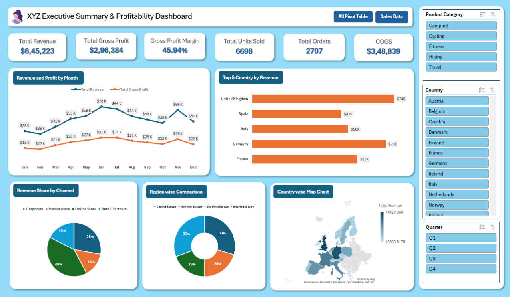

# 📊 Executive Sales Data Dashboard

## 📌 Project Overview

The **Executive Sales Data Dashboard** is an interactive dashboard developed using Microsoft Excel to analyze sales performance, revenue, and profitability. It transforms raw sales data into meaningful business insights through visualizations, KPI cards, Pivot Tables, and interactive slicers.

The dashboard helps users understand monthly sales trends, compare country-wise revenue, and evaluate the performance of different sales channels and regions.

## 🖼️ Dashboard Preview

## ✨ Key Features

- **Key Performance Indicators (KPIs):** Total Revenue, Total Gross Profit, Gross Profit Margin, Total Units Sold, Total Orders, and Cost of Goods Sold (COGS).
- **Monthly Revenue and Profit Analysis:** Tracks revenue and gross profit trends throughout the year.
- **Country-wise Revenue Analysis:** Compares revenue across the top-performing countries.
- **Revenue Share Analysis:** Visualizes revenue distribution across different sales channels.
- **Region-wise Comparison:** Compares the contribution of different regions.
- **Geographical Sales Map:** Displays country-wise revenue performance.
- **Interactive Slicers:** Filter the dashboard by product category, country, and quarter.

## 🛠️ Tools and Technologies

- Microsoft Excel
- Pivot Tables
- Pivot Charts
- Excel Slicers
- Data Analysis and Visualization
- Dashboard Design

## 🎯 Project Objectives

- Analyze overall sales and profitability.
- Identify monthly revenue and gross profit trends.
- Compare sales performance across countries and regions.
- Understand revenue contribution by sales channel.
- Present business data in a clear and interactive visual format.

## 📈 Key Insights

The dashboard provides an overview of sales performance and helps identify revenue trends, profitable markets, and sales channel contributions. The interactive filters allow users to explore the data from different perspectives.

## 🚀 How to Use

1. Download the Excel workbook from this repository.
2. Open the workbook in Microsoft Excel.
3. Navigate to the **Dashboard** worksheet.
4. Use the slicers to filter the data by product category, country, or quarter.
5. Explore the charts and KPIs to understand sales performance.

## 📚 Skills Demonstrated

- Data analysis and interpretation
- Data visualization
- Excel dashboard development
- Pivot Table and Pivot Chart creation
- Interactive reporting
- Business performance analysis

## 👩‍💻 Author

Created as an Excel data analytics project to demonstrate practical skills in business reporting, data analysis, and dashboard design.
